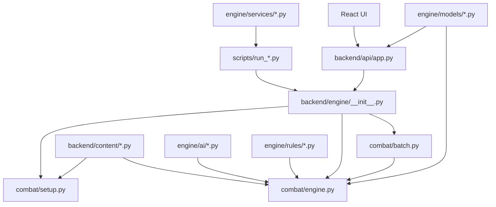

# Python Flow Guide

This guide explains how the Python files in this project fit together. It is written as a map for reading and changing the simulator, not as generated API documentation.

The important architectural rule is simple: the Python backend owns simulation truth. React renders catalogs and replay/state payloads, but combat rules, AI decisions, scenarios, content, batch runs, and audits live in Python.

## Top-Level Flow

## What Happens During A Single Encounter

1. A caller creates an `EncounterConfig`.
   - The caller can be the React UI through FastAPI, a script under `scripts/`, or a test.
   - The config selects seed, player behavior, monster behavior, player preset, enemy preset, placements, batch size, and tuning flags.

2. The caller enters through `backend/engine/__init__.py`.
   - This module exposes lazy wrapper functions: `create_encounter`, `step_encounter`, `run_encounter`, `summarize_encounter`, and `run_batch`.
   - The lazy imports prevent content/model circular imports.

3. `backend/engine/combat/setup.py` builds the initial `EncounterState`.
   - It resolves the player preset from `backend/content/player_loadouts.py`.
   - It resolves the enemy preset from `backend/content/enemies.py`.
   - It validates placements and terrain with `backend/engine/rules/spatial.py`.
   - It applies precombat setup such as smart buffs, resources, initiative, and unit metadata.

4. `backend/engine/combat/engine.py` runs the turn loop.
   - `run_encounter` creates replay frames and repeatedly calls `step_encounter`.
   - `step_encounter` finds the active unit, asks AI for a `TurnDecision`, resolves movement, actions, bonus actions, reactions, effects, damage, death, phase changes, and initiative advancement.
   - Each resolved action becomes one or more `CombatEvent` objects.

5. AI decision-making comes from `backend/engine/ai/decision.py`.
   - AI chooses targets, movement, attacks, spells, bonus actions, and class feature usage.
   - AI should choose among legal options; it should not invent new legality rules that bypass the engine.

6. Rules helpers handle mechanical truth.
   - `backend/engine/rules/spatial.py` handles grid, pathing, reach, cover, line of sight, terrain, hide eligibility, placement validation, and attack legality.
   - `backend/engine/rules/combat_rules.py` handles attack resolution, saves, temporary effects, damage application, healing, class feature mechanics, spell hooks, and cleanup.
   - `backend/engine/rules/spell_resolvers.py` handles spell-specific resolution that would otherwise make `combat_rules.py` too large.
   - `backend/engine/rules/combat_support.py` holds shared DTOs and neutral helpers used by both combat and spell resolution.

7. Models define the payloads.
   - `backend/engine/models/state.py` defines the runtime state, configs, events, effects, damage structures, summaries, and batch job payloads.
   - `backend/engine/models/catalog.py` defines catalog responses consumed by FastAPI and React.

8. The result is returned.
   - A single run returns `RunEncounterResult`.
   - A batch returns `BatchSummary`.
   - An async batch job returns `BatchJobStatus` until it completes.

## What Happens During A Batch Run

1. The caller enters through `run_batch`.
2. `backend/engine/combat/batch.py` expands the requested behavior combinations.
3. It builds deterministic child configs from the base `EncounterConfig`.
4. It chooses serial or parallel execution based on total run count and worker settings.
5. Each run uses the same combat engine, but the fast path avoids replay-frame overhead when full replay history is not needed.
6. Batch accumulators are merged into `BatchSummary` and optional combination summaries.

Batch is not a separate simulator. It is a high-volume orchestration layer around the same engine rules.

## Backend API Files

### `backend/__init__.py`

Package marker for the backend namespace. It has no runtime logic, but it lets Python import `backend.api`, `backend.content`, and `backend.engine` as packages.

### `backend/api/__init__.py`

Package marker for API modules.

### `backend/api/app.py`

FastAPI app and HTTP transport layer.

It exposes:

- `GET /health`
- `GET /api/catalog/enemies`
- `GET /api/catalog/classes`
- `POST /api/encounters/run`
- `POST /api/encounters/batch`
- `POST /api/encounters/batch-jobs`
- `GET /api/encounters/batch-jobs/{job_id}`

This file should stay thin. It translates HTTP requests into calls to `backend.engine` and catalog services, catches `ValueError`, and returns HTTP 400/404 where appropriate. It also rewrites nullable OpenAPI schema branches so Swagger UI handles the generated models more reliably.

### `backend/api/batch_jobs.py`

In-memory async batch-job manager for local use.

It creates a `BatchJobRecord`, stores it in `_BATCH_JOBS`, runs `run_batch` in a background thread, tracks progress, and returns `BatchJobStatus`. It depends on the batch module for total-run math and on the public engine surface for execution.

## Content Files

Content files define the data that setup, AI, and rules consume. Prefer putting numbers, action lists, role tags, spell metadata, and feature grants here before adding special-case runtime branches.

### `backend/content/__init__.py`

Package marker for content modules.

### `backend/content/attack_sequences.py`

Defines player attack-action shapes.

Key types:

- `AttackStepDefinition`
- `AttackActionDefinition`

It builds single-weapon attacks, repeated attacks, Fighter extra attacks, and player attack counts from progression metadata. The combat engine consumes these attack steps so an action can resolve as one or more attacks without hardcoding every class directly in the turn loop.

### `backend/content/class_definitions.py`

Defines class-level metadata in `CLASS_DEFINITIONS`.

`ClassDefinition` stores identifiers, labels, max supported level, hit die, primary ability assumptions, and class tags. Catalog generation reads this file to tell the UI which classes are currently supported.

### `backend/content/class_progressions.py`

Defines level-by-level class progression data in `CLASS_PROGRESSIONS`.

It answers questions such as:

- which features a class gains at a level
- proficiency bonus
- progression scalars such as Sneak Attack dice
- Monk focus points and martial arts die sizes

Runtime code uses `get_class_progression`, `get_progression_scalar`, and related helpers instead of duplicating level tables.

### `backend/content/combat_actions.py`

Registry for named combat actions.

`COMBAT_ACTIONS` describes actions such as Dash, Disengage, Hide, Second Wind, Rage, Steady Aim, bonus attacks, grapples, and special movement actions. Helpers such as `get_extra_movement_multiplier` and `action_prevents_opportunity_attacks` let AI and engine code ask what an action does without knowing which class or monster granted it.

### `backend/content/cunning_strike_definitions.py`

Registry for Rogue Cunning Strike options.

It defines strike metadata, checks whether a unit has a given strike, and computes save DCs. Combat rules use this when a Rogue spends Sneak Attack dice for effects like Trip, Poison, or Withdraw.

### `backend/content/enemies.py`

Primary monster, enemy variant, terrain, and enemy-preset registry.

It defines:

- `MonsterDefinition`
- spellcasting metadata for monsters
- enemy variants
- enemy preset units
- delayed enemy arrivals
- terrain builders such as rocks, boulders, low walls, columns, and frozen-courtyard terrain
- active enemy scenario IDs

Setup reads enemy presets from here to create live enemy units. AI reads role tags, actions, bonus actions, reactions, spells, and monster profiles from these definitions. Tests and audits use this file as the source of truth for monster roster expectations.

### `backend/content/feature_definitions.py`

Feature registry and feature-grant lookup helpers.

It answers questions such as:

- does this unit have `action_surge`, `rage`, `sneak_attack`, `cunning_action`, or `divine_smite`
- which actions, bonus actions, maneuvers, or Cunning Strikes does a feature grant

This file is the bridge between class progression content and runtime action availability.

### `backend/content/maneuver_definitions.py`

Battle Master maneuver registry.

It defines maneuver metadata, checks maneuver ownership, computes superiority die size and save DC, and spends superiority dice. Fighter combat rules use it for precision, trip, push, and related maneuver behavior.

### `backend/content/monster_traits.py`

Monster trait registry.

Traits such as Pack Tactics, Nimble Escape, Rampage, and other monster-specific passive capabilities live here as data. AI and combat rules ask whether a unit has the trait before applying the behavior.

### `backend/content/player_loadouts.py`

Player loadout and player preset registry.

It defines:

- individual player builds
- player preset party compositions
- default player positions and footprints
- class features and resource pools for runtime units
- attack profiles and AC formulas
- skill modifiers such as stealth

`create_player_unit` and `create_player_party_units` convert content definitions into live `UnitState` objects for setup.

### `backend/content/scenario_definitions.py`

Scenario metadata registry.

It maps scenario IDs to display names, active status, descriptions, and validation/audit expectations. Scenario audit tooling uses this file to decide which scenarios are live and what each scenario is supposed to prove.

### `backend/content/special_actions.py`

Definitions for special nonstandard actions.

It covers actions that do not fit cleanly into ordinary weapon attacks, such as dragon breath, legendary sphere actions, cone fear, and single-target save-damage actions. The engine resolves these by looking up special-action definitions and then routing to combat or spell-style resolution helpers.

### `backend/content/spell_definitions.py`

Spell metadata registry.

It defines spell IDs, names, levels, schools, action timing, range, save or attack shape, concentration, scaling, and damage profiles. Spell resolution code reads this metadata and then applies spell-specific mechanics in `spell_resolvers.py`.

## Engine Public Surface

### `backend/engine/__init__.py`

Public import surface for engine callers.

Callers should import from `backend.engine` rather than directly reaching into `backend.engine.combat.engine` when possible. The functions are lazy wrappers around the combat engine. This prevents circular import problems because content modules import model and engine-adjacent helpers.

### `backend/engine/constants.py`

Shared runtime constants.

It holds default seeds, default behavior modes, batch limits, worker limits, legacy unit IDs, known behavior names, and baseline combat constants. New code should prefer content registries for class/monster data, but true global runtime constants belong here.

### `backend/engine/templates.py`

Legacy helper for creating simple fighter and goblin units.

Most modern player and monster setup goes through content registries, but this file remains as a small compatibility/convenience layer for default or older test construction.

## AI Files

### `backend/engine/ai/__init__.py`

Package marker for AI modules.

### `backend/engine/ai/profiles.py`

Monster AI profile registry.

`MonsterAiProfile` describes high-level behavior settings: melee commitment, ranged preference, focus fire, skirmishing, spell usage, and similar policy knobs. `decision.py` uses these profiles when choosing monster turns.

### `backend/engine/ai/decision.py`

Main AI decision engine.

Key types:

- `TurnDecision`
- `MovementPlan`
- `AttackPlan`
- `AttackProjection`
- `SmartTargetFacts`

This file ranks targets, chooses weapons, evaluates spells, chooses movement, decides when to use bonus actions, handles smart vs dumb differences, and applies class/monster behavior profiles. It depends heavily on:

- content files for actions, features, traits, spells, and attack sequences
- `spatial.py` for legal positions and attack contexts
- `combat_rules.py` for effect and state checks
- `state.py` models for typed decisions and unit state

AI should decide intent. The combat engine still resolves whether that intent is legal on the live board.

## Combat Files

### `backend/engine/combat/__init__.py`

Package marker for combat modules.

### `backend/engine/combat/setup.py`

Encounter construction.

It turns `EncounterConfig` into `EncounterState` by:

- resolving player and enemy presets
- building units from content
- resolving terrain
- validating manual or default placements
- resolving player and monster behavior settings
- applying precombat smart buffs
- rolling and sorting initiative

When a run looks wrong before the first turn starts, this is usually the first place to inspect.

### `backend/engine/combat/engine.py`

Main combat runtime.

It owns:

- `run_encounter`
- `step_encounter`
- `summarize_encounter`
- phase changes and combat-end checks
- initiative advancement
- delayed enemy arrivals
- movement and opportunity attack resolution
- action, bonus-action, reaction, and legendary-action execution
- replay-frame generation
- event construction

This file coordinates many helpers, but it should not be treated as the owner of all rules data. It calls into content registries, AI, rules modules, and models to keep the turn loop coherent.

### `backend/engine/combat/batch.py`

Batch execution layer.

It builds deterministic child configs, runs repeated encounters, accumulates win rates and health metrics, supports combined behavior comparisons, and uses parallel workers when a batch is large enough. It avoids replay work when only summary metrics are needed.

## Model Files

### `backend/engine/models/__init__.py`

Package marker for model modules.

### `backend/engine/models/catalog.py`

Pydantic models for catalog responses.

FastAPI uses these as response models for enemy and player catalogs. React consumes the resulting JSON to populate scenario, monster, class, loadout, and preset surfaces.

### `backend/engine/models/state.py`

Core runtime model file.

It defines the simulator's typed state and payloads, including:

- `EncounterConfig`
- `EncounterState`
- `UnitState`
- `CombatEvent`
- `ReplayFrame`
- `RunEncounterResult`
- `BatchSummary`
- `BatchJobStatus`
- terrain, footprints, conditions, resources, weapons, damage details, spell slots, temporary effects, and summaries

If a field must appear in replay JSON, API responses, batch results, or live state, it usually starts here.

## Rules Files

### `backend/engine/rules/__init__.py`

Package marker for rules modules.

### `backend/engine/rules/spatial.py`

Grid, movement, placement, reach, cover, pathing, and attack-context rules.

It handles:

- board bounds
- footprints and occupied squares
- terrain blocking and half cover
- line of sight
- hide-supporting terrain
- grapple reach
- pathfinding
- opportunity attack triggers
- flanking and Pack Tactics context
- legal attack checks
- placement validation

If the question is "can this unit stand here, move there, see this target, reach this target, or hide here," this file is usually involved.

### `backend/engine/rules/combat_support.py`

Shared combat DTOs and neutral helpers.

It defines attack and saving throw override structures, damage-application results, event helpers, ability modifier helpers, spell-slot spending, healing application, and final damage component formatting. It exists so spell resolution and combat rules can share basic machinery without creating import cycles.

### `backend/engine/rules/combat_rules.py`

General combat rules and effect resolution.

It handles:

- attack roll mode and damage resolution
- advantage and disadvantage sources
- temporary effect cleanup
- rage, reckless attack, hidden, dodging, shield, Bless, Divine Favor, Heroism, Haste, frightened, grapple, restraint, and similar effects
- death saves and stabilization
- healing and Lay on Hands
- class feature mechanics
- attack riders and on-hit effects
- spell hooks exported from `spell_resolvers.py`

This file is the mechanical rulebook for ordinary combat. Keep reusable mechanics centralized here instead of scattering them across AI branches.

### `backend/engine/rules/spell_resolvers.py`

Spell-specific mechanics.

It resolves spell attacks, save spells, Magic Missile, Scorching Ray, Burning Hands, Ray of Sickness, Counterspell, cantrip scaling, clustered target validation, and other spell behaviors. This keeps spell details from overwhelming the general combat rules module.

## Service Files

Services compose engine runs into reports or catalog payloads. They are not the core simulator, but they are how scripts and audits ask higher-level questions.

### `backend/engine/services/__init__.py`

Package marker for services.

### `backend/engine/services/catalog.py`

Builds enemy and player catalog responses from content registries.

FastAPI uses this service for `/api/catalog/enemies` and `/api/catalog/classes`. It bridges content definitions into UI-ready JSON.

### `backend/engine/services/fighter_audit.py`

Fighter-specific audit service.

It runs fixed-seed replay probes, batch health passes, smart-vs-dumb comparisons, action-surge checks, weapon-use metrics, and preset aggregates for Fighter behavior.

### `backend/engine/services/barbarian_audit.py`

Barbarian-specific audit service.

It measures Rage usage, weapon behavior, stuck-turn signals, health outcomes, smart underperformance, and preset-level aggregate behavior for Barbarian scenarios.

### `backend/engine/services/rogue_audit.py`

Rogue-specific audit service.

It measures Sneak Attack, Hide, Disengage, bonus Dash, signature probes, smart underperformance, and preset-level Rogue health metrics.

### `backend/engine/services/scenario_audit.py`

Scenario-level audit service.

It checks whether active scenarios build correctly, smoke-run successfully, and exhibit expected mechanics such as multiattack, Pack Tactics, swallow, reaction behavior, staged arrivals, and scenario-specific signatures.

## Utility Files

### `backend/engine/utils/__init__.py`

Package marker for utility modules.

### `backend/engine/utils/helpers.py`

Small state and sorting helpers.

It includes cloning, unit sorting, faction filtering, conscious/dead/stable checks, reaction eligibility, remaining HP, winner determination, and winner text.

### `backend/engine/utils/rng.py`

Deterministic seeded random number helpers.

`normalize_seed`, `next_rng_state`, `roll_die`, and `roll_dice` keep encounter and batch runs reproducible. Determinism depends on using these helpers consistently instead of Python's global random module.

## Script Files

Scripts are command-line entry points for audits, reports, diagnostics, and development workflows. Most scripts import from `backend.engine`, `backend.engine.services`, or shared script helpers.

### `scripts/audit_common.py`

Shared helpers for audit scripts: git context, report writing, JSON loading, output tails, status counts, and relative paths.

### `scripts/audit_findings.py`

Registry of monitored audit findings and active waivers. Nightly and clarity tooling use it to classify known risks.

### `scripts/freeze_baseline_report.py`

Builds a frozen baseline report for a selected scenario set. It captures config and git context so future reviews can compare against a known point.

### `scripts/investigate_barbarian_stall.py`

Diagnostic script for Barbarian stall behavior. It runs child probes, detects slow or stuck seeds, classifies probe sets, and writes Markdown/JSON reports.

### `scripts/investigate_smart_vs_dumb.py`

Deep diagnostic script for paired smart-vs-dumb behavior. It captures turn evidence, target priorities, movement options, pair results, and counterexample data.

### `scripts/review_python_goldens.py`

Golden fixture review and update helper.

It compares current run and batch behavior to fixture payloads, finds first divergent events, requires classification for fixture writes, and writes review reports.

### `scripts/run_audit_validation.py`

Meta-audit for the audit system itself.

It checks documented commands, pytest inventory, test signal quality, coverage maps, runtime budget risks, stale reports, and canary validation.

### `scripts/run_barbarian_audit.py`

CLI wrapper around `backend.engine.services.barbarian_audit`.

It parses arguments, optionally runs a rules gate, executes the audit service, and writes JSON/Markdown reports.

### `scripts/run_class_audit_slices.py`

Runs class audit slices in smaller segments.

It builds per-class/per-scenario commands, skips existing reports when allowed, handles timeouts, and writes a summary. This is used when full class audits are too heavy for one run.

### `scripts/run_code_health_audit.py`

Code health report.

It counts large live modules, detects legacy frontend engine imports, spots root artifacts, runs selected benchmarks, and writes a health summary.

### `scripts/run_daily_housekeeping.py`

Daily repo health and cleanliness report.

It classifies git status, checks doc drift, validates lightweight project state, recommends whether a commit is safe, and writes the latest housekeeping report.

### `scripts/run_fighter_audit.py`

CLI wrapper around `backend.engine.services.fighter_audit`.

It mirrors the Barbarian audit runner shape for Fighter behavior validation.

### `scripts/run_nightly_audit.py`

Nightly audit orchestrator.

It runs backend gates, rotating class slices, scenario audits, code health checks, and report parsing. It manages rotation state and writes a consolidated nightly report.

### `scripts/run_party_battery.py`

Small party battery runner.

It runs selected party behaviors, monster behaviors, seeds, and scenarios through batch mode for quick high-level comparison.

### `scripts/run_party_validation.py`

Current-party validation runner.

It combines rules gates, replay smoke tests, batch health runs, feature evidence, CSV/Markdown summary tables, and scenario validation for the active mixed party.

### `scripts/run_pass2_stability.py`

Stability audit.

It checks replay determinism, batch determinism, async job progress behavior, known warnings, long audit commands, and report payload stability.

### `scripts/run_pass3_clarity.py`

Clarity audit.

It validates canonical report shape, status vocabulary, findings shape, required doc text, and command documentation.

### `scripts/run_pc_tuning_sample.py`

PC tuning sampler.

It runs selected party profiles, records feature-specific metrics for Paladin, Wizard, Rogue, Fighter, and party summaries, and writes tuning reports.

### `scripts/run_rogue_audit.py`

CLI wrapper around `backend.engine.services.rogue_audit`.

It parses Rogue audit options, runs optional pytest gates, executes the service, and writes reports.

### `scripts/run_scenario_audit.py`

CLI wrapper around `backend.engine.services.scenario_audit`.

It supports quick/full scenario audit profiles and writes scenario audit reports.

### `scripts/run_smart_logic_matrix.py`

Smart-logic comparison runner.

It compares current and reference smart-logic variants across scenarios, aggregates metrics, and writes recommendations.

### `scripts/tuning_policy.py`

Shared tuning-policy helpers.

It defines Lay on Hands policy defaults, validation, and config-kwargs generation for scripts and tests.

## Test Files

Tests are organized by what they protect. Most rule tests build fixed configs and call the Python engine directly.

### `tests/golden/test_python_goldens.py`

Golden parity tests for fixed run and batch fixtures.

### `tests/integration/test_api.py`

FastAPI integration tests for health, catalogs, run, batch, async batch jobs, default placements, validation errors, and OpenAPI schema shape.

### `tests/rules/action_assertions.py`

Shared assertion helper for validating attack-action payloads in tests.

### `tests/rules/monster_expectations.py`

Typed expectation table for monster content tests.

### `tests/rules/test_ai.py`

Large AI behavior test suite. It checks smart/dumb choices, target selection, movement, class behaviors, spell use, action economy, and tactical edge cases.

### `tests/rules/test_audit_validation.py`

Tests the audit-validation script and its coverage, command, runtime, and report-quality checks.

### `tests/rules/test_barbarian_audit.py`

Tests Barbarian audit defaults, metric extraction, fixed-seed probes, smart underperformance classification, and report formatting.

### `tests/rules/test_class_audit_slices.py`

Tests segmented class audit slice construction, skipping, timeout handling, and summary behavior.

### `tests/rules/test_crocodile.py`

Focused crocodile behavior tests for large footprint, bite, grapple, release, death cleanup, and marsh predator behavior.

### `tests/rules/test_daily_housekeeping.py`

Tests repo state classification, doc drift checks, and safe commit recommendation logic.

### `tests/rules/test_fighter_audit.py`

Tests Fighter audit defaults, metric extraction, fixed-seed probes, action-surge evidence, smart underperformance classification, and report formatting.

### `tests/rules/test_giant_toad.py`

Focused giant toad tests for large footprint, bite, grapple, swallow, acid, release, reach, and fixed-seed encounter behavior.

### `tests/rules/test_grapple_rules.py`

Tests generic grapple validity, inactive grapples, cleanup, stale grapple targeting, and attack skipping when legal steps disappear.

### `tests/rules/test_monster_behavior.py`

Broad monster mechanics test suite for benchmark attacks, spells, riders, auras, pushes, Pack Tactics, grapples, reactions, and special monster behavior.

### `tests/rules/test_monster_benchmarks.py`

Tests benchmark presets, first-step behavior, batch health metrics, and replay behavior across DM modes.

### `tests/rules/test_monster_content.py`

Tests monster roster/content expectations and workbook-modeled status.

### `tests/rules/test_nightly_audit.py`

Tests nightly report parsing, rotation state, backend gates, rotating class slices, runtime summaries, and report sections.

### `tests/rules/test_party_validation.py`

Tests party validation defaults, combined batch accounting, report shape, CLI controls, replay smoke, batch health, and audit entrypoints.

### `tests/rules/test_pass2_stability.py`

Tests determinism comparison rows, replay/batch mismatch detection, async progress regression, known warning handling, and report payload shape.

### `tests/rules/test_pass3_clarity.py`

Tests canonical report helpers, audit findings, required docs, known findings, waivers, and clarity report shape.

### `tests/rules/test_pc_tuning_sample.py`

Tests PC tuning defaults, profile selection, Lay on Hands policy config, feature metrics, party breakdowns, and compact console output.

### `tests/rules/test_player_framework.py`

Tests class/loadout/progression framework behavior, runtime metadata, attack counts, feature grants, spell metadata, resources, and player catalog consistency.

### `tests/rules/test_presets.py`

Tests enemy/player preset layouts, staged encounters, delayed arrivals, combined batch support, and active scenario construction.

### `tests/rules/test_review_python_goldens.py`

Tests golden review divergence detection, fixture write validation, and selected fixture update behavior.

### `tests/rules/test_rogue_audit.py`

Tests Rogue audit defaults, metric extraction, signature probes, smart underperformance classification, and report formatting.

### `tests/rules/test_rules.py`

Large rules test suite for class mechanics, spells, attacks, saves, effects, healing, resources, combat state transitions, and feature interactions.

### `tests/rules/test_scenario_audit.py`

Tests active scenario audit metadata, staged scenario expectations, simple suggestions, diagnostic warnings, and scenario report payloads.

### `tests/rules/test_smart_logic_matrix.py`

Tests smart-logic variant configuration, paired seed generation, target priority differences, feature flags, aggregates, and recommendations.

### `tests/rules/test_smart_vs_dumb_diagnostics.py`

Tests paired smart/dumb diagnostics, underperformance classification, turn evidence capture, and Markdown counterexample output.

### `tests/rules/test_spatial.py`

Tests movement, flanking, range, cover, pathing, opportunity attacks, terrain, hide eligibility, line-of-sight behavior, and spatial rule edge cases.

### `tests/rules/test_spell_import_boundaries.py`

Tests that spell resolver imports preserve the intended boundary with legacy `combat_rules.py` imports.

## How The Layers Should Be Changed

Use this order for most simulator changes:

1. Add or adjust content data first.
   - Classes, levels, loadouts, monsters, scenarios, spells, actions, features, and traits belong in `backend/content`.

2. Add or adjust model fields only when payload/state needs a new shape.
   - Runtime state and API payloads belong in `backend/engine/models/state.py`.
   - Catalog payloads belong in `backend/engine/models/catalog.py`.

3. Add reusable rule mechanics.
   - Spatial legality belongs in `spatial.py`.
   - General combat mechanics belong in `combat_rules.py`.
   - Spell-specific mechanics belong in `spell_resolvers.py`.
   - Shared DTO/helper pieces belong in `combat_support.py`.

4. Teach AI how to choose the new option.
   - Use content metadata and rule legality helpers.
   - Keep smart/dumb differences explicit and testable.

5. Wire the turn loop only when the engine needs to execute a new action shape.
   - The turn loop should coordinate, not become the data registry.

6. Add tests at the right layer.
   - Content and catalog tests for data exposure.
   - Spatial tests for map legality.
   - Rules tests for mechanical resolution.
   - AI tests for decisions.
   - Integration tests for API contracts.
   - Golden review only after targeted behavior is understood.

## Practical Reading Paths

### To understand a UI run

1. `backend/api/app.py`
2. `backend/engine/__init__.py`
3. `backend/engine/combat/setup.py`
4. `backend/engine/combat/engine.py`
5. `backend/engine/ai/decision.py`
6. `backend/engine/rules/combat_rules.py`
7. `backend/engine/models/state.py`

### To understand a class feature

1. `backend/content/class_definitions.py`
2. `backend/content/class_progressions.py`
3. `backend/content/feature_definitions.py`
4. `backend/content/player_loadouts.py`
5. `backend/content/combat_actions.py`
6. `backend/engine/ai/decision.py`
7. `backend/engine/rules/combat_rules.py`
8. `backend/engine/combat/engine.py`
9. `tests/rules/test_player_framework.py`, `tests/rules/test_rules.py`, and `tests/rules/test_ai.py`

### To understand a monster or scenario

1. `backend/content/enemies.py`
2. `backend/content/monster_traits.py`
3. `backend/content/special_actions.py`
4. `backend/content/spell_definitions.py`
5. `backend/engine/ai/profiles.py`
6. `backend/engine/ai/decision.py`
7. `backend/engine/rules/combat_rules.py`
8. `backend/engine/rules/spell_resolvers.py`
9. `tests/rules/test_monster_behavior.py`, `tests/rules/test_monster_content.py`, and `tests/rules/test_presets.py`

### To understand audits and reports

1. `scripts/run_daily_housekeeping.py`
2. `scripts/run_party_validation.py`
3. `scripts/run_nightly_audit.py`
4. `backend/engine/services/scenario_audit.py`
5. `backend/engine/services/fighter_audit.py`
6. `backend/engine/services/barbarian_audit.py`
7. `backend/engine/services/rogue_audit.py`
8. `scripts/audit_common.py`

## Common Ownership Rules

- API transport belongs in `backend/api`.
- Content data belongs in `backend/content`.
- Runtime payload/state shapes belong in `backend/engine/models`.
- Turn orchestration belongs in `backend/engine/combat`.
- Mechanical rules belong in `backend/engine/rules`.
- Behavior choice belongs in `backend/engine/ai`.
- Report orchestration belongs in `backend/engine/services` and `scripts`.
- Regression protection belongs in `tests`.

When in doubt, ask: "Is this data, legality, decision-making, execution, transport, or validation?" That answer usually points to the right `.py` file.
